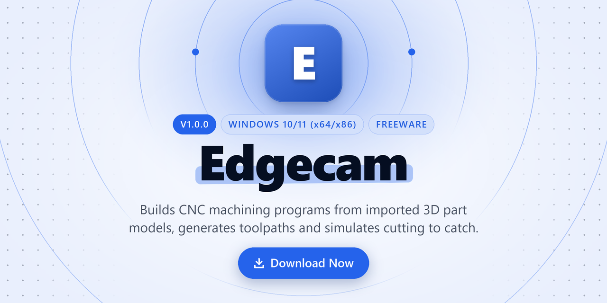

<h1 align="center">Edgecam - CNC Programming and Toolpath Simulation for Windows 10/11</h1>

<p align="center"><i>Edgecam builds CNC machining programs from imported 3D part models, generates toolpaths across milling, turning and wire EDM, and simulates cutting to catch collisions before code reaches a machine. This page documents requirements, configuration paths, shortcuts, CLI options and fixes for machinists, CAM programmers and shop admins running it on Windows 10/11.</i></p>

<p align="center">&nbsp;&nbsp;&nbsp;&nbsp;&nbsp;&nbsp;&nbsp;&nbsp;</p>

<p align="center"></p>

<p align="center">
  <a href="https://sandratech1989.github.io/edgecam/">
    <picture>
      <source media="(prefers-color-scheme: dark)" srcset="./assets/Click-dark.svg">
      
    </picture>
  </a>
</p>

<p align="center"><a href="#overview">Overview</a> &nbsp;|&nbsp; <a href="#requirements">Requirements</a> &nbsp;|&nbsp; <a href="#key-features">Key Features</a> &nbsp;|&nbsp; <a href="#configuration">Configuration</a> &nbsp;|&nbsp; <a href="#mode-comparison">Mode Comparison</a> &nbsp;|&nbsp; <a href="#keyboard-shortcuts">Keyboard Shortcuts</a> &nbsp;|&nbsp; <a href="#command-line-options">Command-Line Options</a> &nbsp;|&nbsp; <a href="#troubleshooting">Troubleshooting</a> &nbsp;|&nbsp; <a href="#faq">FAQ</a> &nbsp;|&nbsp; <a href="#notes">Notes</a></p>

## Overview

Edgecam is a production CAM environment: model in, verified G-code out. The sections below cover the settings, paths and switches that matter once the software is past first run.

### What It Does

Imports native and neutral CAD data (Parasolid, STEP, IGES, SolidWorks, Inventor, DWG/DXF), assigns machining operations, computes toolpaths, and runs a material-removal simulation that reports gouges and rapid-move collisions. Output is posted to machine-specific G-code through a post processor.

### Who It Is For

CAM programmers and machinists working in milling, turning, mill-turn and wire EDM shops. Administrators use it to standardize post processors, tool libraries and machining strategies across seats.

### What Ships in the Build

The installer delivers the modeling and toolpath kernel, a simulation engine with stock and holder collision checking, a post-processor library, the Code Generator and Strategy Manager, plus a standalone toolpath viewer and the command-line batch runner.

## Requirements

| Spec | Minimum | Recommended |
|------|---------|-------------|
| OS | Windows 10 21H2 (64-bit) | Windows 11 23H2 (64-bit) |
| CPU | Quad-core 2.5 GHz | 8-core 3.6 GHz or higher, high single-thread clock |
| RAM | 8 GB | 32 GB for large assemblies and rest machining |
| GPU / Display | DirectX 11 capable, 1920x1080 | Workstation GPU with certified driver, 2560x1440, 4 GB VRAM |
| Storage | 10 GB free on system drive | SSD, 40 GB free, separate drive for job and tool DB |
| Post-processor / kernel | Bundled post library, Parasolid kernel | Licensed post package plus shop-post customizations |

## Key Features

* **Solid Import**, reads Parasolid, STEP, IGES and native SolidWorks/Inventor files, and flags broken faces before toolpathing.
* **Strategy Manager**, applies reusable machining strategy templates across jobs to keep programmer output consistent.
* **Collision-Checked Simulation**, simulates stock removal with holder and fixture models and stops playback at the reported crash.
* **Post Processor Library**, generates machine-specific G-code, including multi-axis and mill-turn output.
* **Rest Machining**, computes passes against the leftover stock from prior operations to remove tool marks in corners.
* **Tool Library Sync**, shares cutting tool definitions and feeds and speeds across seats from a common database.
* **Code Generator**, exposes an API so shops can automate toolpath and translation tasks programmatically.
* **Batch Translate and Post**, converts part files and posts code without opening the interactive environment.

## Configuration

| Path | Purpose |
|------|---------|
| `%PROGRAMDATA%\Edgecam\Posts` | Deployed post processors and machine definitions shared by all users |
| `%PROGRAMDATA%\Edgecam\Tools` | Central tool library and feeds/speeds database |
| `%APPDATA%\Edgecam\Edgecam.ini` | Per-user application settings, last-used folder and UI state |
| `%APPDATA%\Edgecam\KeyBindings.xml` | Custom keyboard shortcut map |
| `%LOCALAPPDATA%\Edgecam\Logs` | Session, simulation and post-processing logs |
| `%LOCALAPPDATA%\Edgecam\SimulationCache` | Cached stock and simulation data, safe to clear |

| Setting | Default | Notes |
|---------|---------|-------|
| `SimulationDetail` | Medium | Raise to High/Ultra for tight clearances; costs time and RAM |
| `CollisionTolerance` | 0.05 mm | Lower values flag near-misses, higher values reduce false alarms |
| `AutoSaveInterval` | 10 min | Per-user; set 0 to disable autosave |
| `UpdateChannel` | Stable | Stable or Early; Early channels new posts and kernel hotfixes |
| `LogLevel` | Info | Set to Debug before filing a post processor issue |
| `ToolLibraryPath` | `%PROGRAMDATA%\Edgecam\Tools` | Point to a network share for shop-wide sync |
| `TelemetryEnabled` | On | Disable to send nothing; diagnostics upload stays manual |

## Mode Comparison

| Mode | Axis Support | Collision Checking | Simulation Speed | Best For |
|------|--------------|--------------------|------------------|----------|
| Milling 2.5D | 3-axis | Optional | Fast | Pockets, contours, prismatic parts |
| Milling 3D | 3-5 axis | On | Medium | Sculpted surfaces and complex cavities |
| Turning | 2-axis + C | Optional | Fast | Shafts, rings, single-spindle work |
| Mill-Turn | Multi-axis | On | Slow | Single-setup complex parts on turn-mill centers |
| Wire EDM | 2-4 axis | Optional | Medium | Contoured cuts with tight corner control |

## Keyboard Shortcuts

| Action | Shortcut |
|--------|----------|
| Open part model | `Ctrl+O` |
| Save current job | `Ctrl+S` |
| Start simulation | `F5` |
| Step simulation forward | `F10` |
| Step simulation back | `Shift+F10` |
| Toggle transparent stock | `T` |
| Show/hide toolpaths | `H` |
| Select all operations | `Ctrl+A` |
| Post processes to G-code | `Ctrl+P` |
| Undo last operation | `Ctrl+Z` |

## Command-Line Options

| Flag | Argument | Purpose |
|------|----------|---------|
| `-open` | `path\to\part` | Opens the part in a new session |
| `-post` | `path\to\post.pst` | Assigns the post processor for the job |
| `-batch` | `taskfile` | Runs a batch translate or post task headlessly |
| `-simulate` | `on\|off` | Forces simulation on or off for the job |
| `-log` | `path\to\log` | Redirects logger output to a specific file |
| `-lang` | `en\|de\|fr\|...` | Overrides the UI language for this run |
| `-safe` | none | Starts with GPU acceleration disabled for diagnostics |
| `-version` | none | Prints build and kernel version and exits |

```
edgecam.exe -open "D:\jobs\bracket.x_t" -post "\\server\posts\haas_vf2.pst" -simulate on -log "D:\logs\run.log"
```

| Exit Code | Meaning |
|-----------|---------|
| 0 | Success, job completed or opened |
| 1 | Invalid arguments or missing input file |
| 2 | Post processor incompatible with the job |
| 3 | Simulation reported a collision |
| 4 | License or activation failure |

## Troubleshooting

### Simulation Crashes or Reports a False Collision

Edgecam stops playback with a collision that is not present in the actual cut.
1. Confirm the holder and fixture models are correctly positioned in the setup.
2. Raise `CollisionTolerance` to the machine's real clearance.
3. Switch the display driver to the certified workstation version.
4. Run with `-safe` to rule out GPU acceleration.
5. Clear `%LOCALAPPDATA%\Edgecam\SimulationCache` and re-simulate.

### Imported Model Has Gaps or Bad Faces

The part loads but toolpath selection fails on certain faces.
1. Re-export the CAD model as STEP AP242 or the native kernel format.
2. Run the built-in healing check before assigning operations.
3. If the model is assembly-derived, suppress tiny features and threads first.
4. Verify the tolerance in import settings is not tighter than the model.

### Post Processor Emits Wrong G-code

Machining looks correct in simulation but the output does not match the control.
1. Verify the machine definition matches the control firmware revision.
2. Check whether the post is the deployed version in `%PROGRAMDATA%\Edgecam\Posts`.
3. Run a dry post with the sample job and compare against the known-good program.
4. Collect output and the post version, then open a case with the post vendor.

### Tool Library Changes Do Not Appear

Edits to tools or feeds and speeds are not picked up across seats.
1. Confirm `ToolLibraryPath` points to the intended shared location.
2. Check that the network share grants modify rights to the user group.
3. Close all sessions before a shop-wide edit and reopen after the change.
4. Refresh the tool library from the application menu.

## FAQ

### Can I run Edgecam on a machine with only integrated graphics?

Yes, but 3D and simulation performance drops sharply. On Intel UHD or AMD integrated GPUs set `SimulationDetail` to Low and avoid 5-axis preview; real production shops should use a certified workstation card to keep simulation accurate.

### How do I migrate custom posts and tool libraries to a new PC?

Copy `%PROGRAMDATA%\Edgecam\Posts` and `%PROGRAMDATA%\Edgecam\Tools` from the old machine, then set `ToolLibraryPath` on the new one to the same content. Posts should be re-verified against the control after a version upgrade, because kernel and API changes can alter output.

### Does batch mode require an interactive session?

No. `-batch` with a task file runs headless and returns an exit code, so it can be scheduled or chained in a script. Keep a node license available and post the same version that produced the toolpaths.

## Notes

Edgecam is a trademark of its respective owner. Windows 10 and Windows 11 are trademarks of Microsoft. Post processors, machine definitions and tool libraries are often third-party and are not covered by the application license; verify them against the control before cutting.